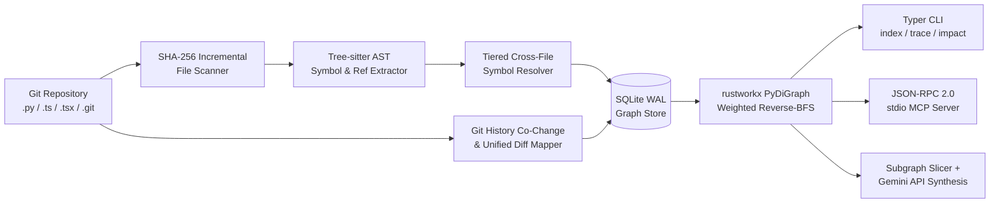

# GraphTrace

**Deterministic Structural & Evolutionary Codebase Impact Analysis Engine**

GraphTrace parses Python and TypeScript/JavaScript repositories into a persistent **Structural + Evolutionary Dependency Graph** (Tree-sitter AST + SQLite WAL + `rustworkx`), enabling engineers and AI coding agents to compute exact transitive blast radius, select minimal test subsets from `git diff`, and query architectural impact with verifiable file:line citations.

---

## Architecture



## Key Engineering Capabilities

1. **Incremental Content-Addressable Indexing:** Tracks per-file SHA-256 hashes in SQLite WAL mode, re-parsing only modified files and cascading stale edge cleanup.
2. **Tiered Cross-File Symbol Resolution:** Resolves relative imports, Python package paths, and `tsconfig.json` path aliases across four confidence tiers (`1.0` explicit import $\to$ `0.65` project-wide symbol match).
3. **Hybrid Static + Evolutionary Coupling:** Fuses AST edges (`CALLS`, `INHERITS`, `IMPORTS`) with confidence-filtered Git co-change edges (`CO_CHANGES`) to catch implicit cross-boundary dependencies.
4. **Zero-Context `git diff` Hunk-to-Symbol Mapping:** Intersects `git diff --unified=0` line spans with AST symbol boundaries to compute downstream blast radius and emit minimal `pytest` / `vitest` commands.
5. **Subgraph-Grounded Synthesis & MCP Server:** Slices 2-hop upstream/downstream neighborhoods wrapped in prompt-injection-safe `<untrusted_code_context>` blocks for Gemini API synthesis and exposes `get_blast_radius` and `get_impacted_tests` via stdio MCP.

## Quickstart

```bash
python -m venv .venv
source .venv/bin/activate        # Windows: .venv\Scripts\Activate.ps1
pip install -e ".[dev]"

# 1. Index a repository
graphtrace index .

# 2. Trace downstream blast radius of any symbol
graphtrace trace SymbolResolver

# 3. Analyze uncommitted git diff and get minimal test command
graphtrace impact

# 4. Ask a subgraph-grounded architectural question (requires GEMINI_API_KEY)
graphtrace ask "What breaks if I change the return structure of compute_blast_radius?"
```

## Benchmarks & Known Limitations

Run the reproducible benchmark suite:
```bash
python benchmarks/run_benchmark.py
```

* **Multi-Hop Recall:** Achieves **100% recall** across 4-hop call chains (`core -> helper -> service -> controller -> test`) where naive lexical search achieves **25% recall** (missing downstream callers that do not reference the leaf symbol by name).
* **Selective CI Reduction:** Cuts test execution scope by **98%** on single-module changes while retaining 100% recall on affected tests.
* **Known Limitations:**
  * Dynamic runtime dispatch (`getattr`, dependency-injection containers, reflection) is approximated via heuristic tier-4 matching (`confidence <= 0.65`) rather than full type-inference execution.
  * Currently supports Python and TypeScript/JavaScript; Go, Rust, and Java Tree-sitter grammars are planned extensions.